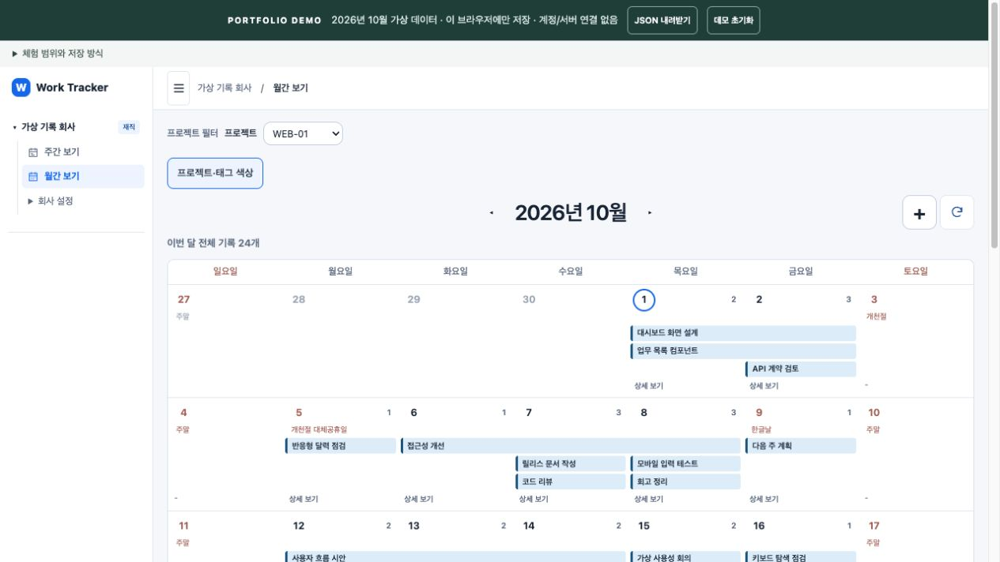
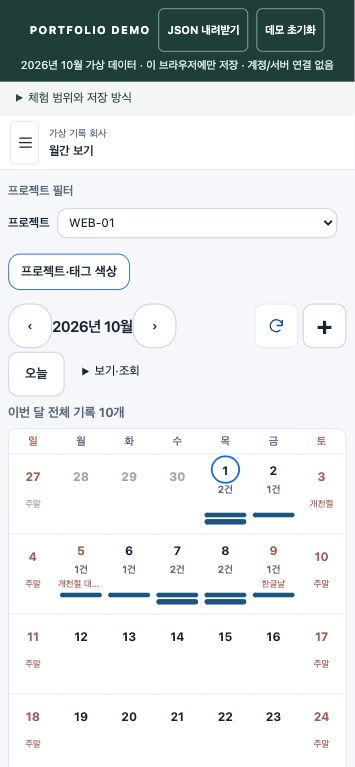
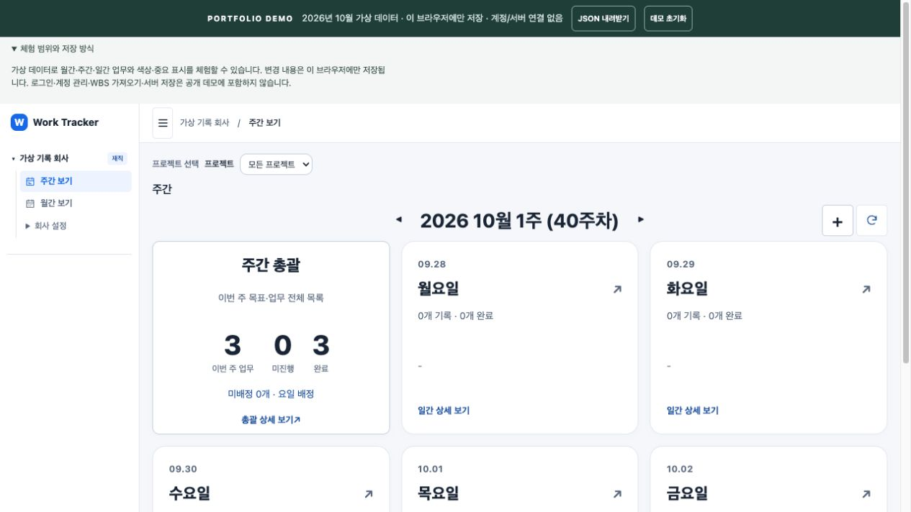

# Work Tracker

업무와 일정을 월간·주간·일간으로 연결해 관리하는 개인 프로젝트입니다. 프로젝트별 업무 흐름을 살펴보고, 하루의 기록과 완료 상태를 같은 맥락에서 확인하도록 구성했습니다.

## 운영 서비스의 화면과 기능

아래는 운영 서비스의 화면 구성입니다. 이 저장소의 공개 데모는 실제 계정·업무·DB를 연결하지 않는 별도 체험본입니다.

| 화면 | 역할 |
| --- | --- |
| 월간 | 날짜별 업무·일정을 살펴보고 프로젝트와 분류 색상으로 구분 |
| 주간 | 선택한 주의 요일별 업무와 완료 상태를 함께 확인 |
| 일간·업무 상세 | 하루의 기록과 개별 업무를 확인하고 내용을 수정 |
| 휴가 기록 | 종일 휴가인 날 연결 업무를 화면에서 숨기되 기존 기록과 연결 관계는 보존. 일간 휴가 상세에서 취소하면 업무를 다시 표시하고, 취소 복원 시 다시 숨김 |
| WBS | 직접 작성하는 일간 업무와 분리해 연간 계획을 관리 |
| 기간 내보내기 | 회사 자료를 기준으로 선택 기간의 XLSX·JSON 자료 생성 |

월간·주간·일간 이동에서는 선택한 날짜와 프로젝트 맥락을 유지합니다. 운영 서비스의 인증·서버 저장·WBS 처리와 공개 데모의 브라우저 저장은 서로 다른 경로입니다.

## 공개 데모의 범위

기존 UI에서 분리한 **가상 데이터 전용 포트폴리오 데모**입니다. 10월 다섯 주와 여러 날 이어지는 업무를 포함하는 2026년 10월의 가상 회사와 기록 24개 (업무 21개·회의 2개·행사 1개)로 월간·주간·일간 화면을 체험합니다. 실제 계정·업무 자료·운영 서버·원본 Git 이력은 포함하지 않습니다.

- 가상 업무 추가·수정·완료, 업무와 분류 색상, 개인 중요 표시
- 변경은 이 브라우저에만 저장되며 **데모 초기화**로 예시 24개를 복원
- JSON 내려받기는 업무와 업무 색상만 포함하며, 분류색·중요 표시·메모를 포함하는 전체 백업은 아님
- 일간·주간 메모 작성·저장, 반복 일정·로그인·계정 관리·실제 WBS 가져오기·서버 저장·문서 확정은 제공하지 않음
- 과거 주간 집계는 보존 이력이 없는 공개 데모에서 숨김

## 웹 데모

**[Work Tracker 데모 열기](https://si-planet.github.io/worktracker-portfolio/)**

복사할 주소: `https://si-planet.github.io/worktracker-portfolio/`

로그인 없이 가상 업무를 체험할 수 있습니다. 수정 내용은 현재 브라우저에만 저장되며 실제 서비스나 다른 기기와 동기화되지 않습니다. 초기 예시의 일정·기록 시각은 고정되어 있지만, 직접 생성·수정·완료한 시각은 조작할 때의 기기 시각을 기록합니다. 기본 중요 표시는 원래 예시의 ID에 연결되어 삭제나 정렬로 다른 업무에 옮겨가지 않습니다.

화면 이미지는 실제 업무가 아닌 공개 데모의 가상 자료입니다. 상세 검사 이력과 검증 한계는 [검증 기록](VERIFICATION.md)에 별도로 정리합니다.

## 실행 / 게시 설정

`docs/`에 미리 빌드한 정적 파일이 포함되어 있습니다. GitHub Pages에서 **Deploy from a branch → main → /docs**를 선택하면 됩니다. 저장소 이름을 바꿔도 빌드 설정 수정이 필요하지 않습니다. 공유 링크는 `/#/c/…/day?date=…` 형태이며 새로고침도 동작합니다.

공개 소스: [si-planet/worktracker-portfolio](https://github.com/si-planet/worktracker-portfolio). 비공개 이력 없이 정제한 파일로 새 이력을 시작했습니다.

웹 데모는 GitHub Pages의 `main /docs`에서 게시됩니다. 이후 게시·검사·업데이트 절차는 [GitHub Pages 안내](PUBLISH.md)에 있습니다.

로컬 실행은 Python 3만 필요합니다.

```sh
python3 scripts/serve.py --port 8899
```

`http://127.0.0.1:8899/`를 엽니다. 실제 데이터는 입력하지 마세요.

## 개발 / 확인

Node.js 24 이상, npm, Python 3을 사용합니다. 호스팅 자체에는 Node나 npm이 필요하지 않습니다.

```sh
npm ci --ignore-scripts
npm run build
npm run check
```

`npm run build`는 정적 배포 파일을, `npm run check`는 공개 범위·가상 자료·정적 실행 검사를 확인합니다. 검사 이력은 [검증 기록](VERIFICATION.md)을 참조하세요.

`web/`, `shared/`는 검토된 UI 소스 스냅샷입니다. 브라우저 라우팅·합성 API·저장은 `demo/`가 담당하며 제품 소스의 라우팅과 문서 체험 범위는 빌드 중에만 공개 전용 어댑터로 연결합니다. 재사용 권한은 [NOTICE.md](NOTICE.md), 제3자 라이선스는 [THIRD_PARTY_NOTICES.md](THIRD_PARTY_NOTICES.md)를 확인하세요.






